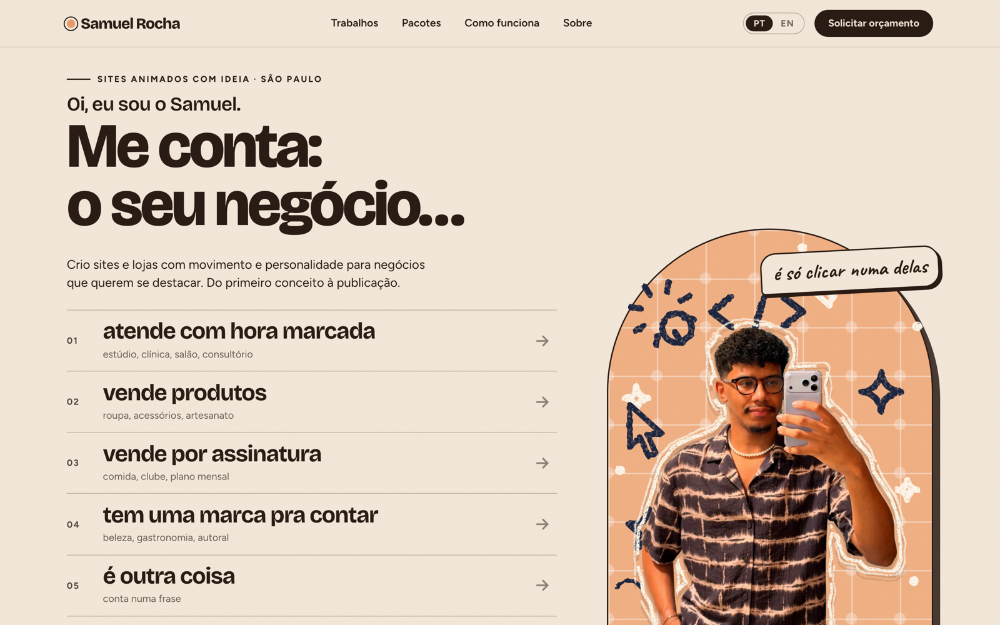

<h1 align="center">Oi, eu sou o Samuel 👋</h1>

  Estudante de Gestão de TI, com base em produto, dados e IA. São Paulo. 
  Hi, I'm Samuel. IT Management student focused on product, data and AI. São Paulo, Brazil.

  <a href="https://samuelrocha-portfolio.vercel.app"><b>Portfólio</b></a>
  ·
  <a href="https://www.linkedin.com/in/samuelhrocha"><b>LinkedIn</b></a>
  ·
  <a href="https://github.com/s1mh/north"><b>north.</b></a>
  ·
  <a href="https://github.com/s1mh/contacasal"><b>Conta de Casal</b></a>

---

## Português

Eu sou estudante do 4º semestre de Tecnologia em Gestão da TI na Faculdade Impacta e venho de operações financeiras: são mais de 3 anos no Nubank, hoje como analista de fraude pleno, onde automatizo processos, monto dashboards e analiso dados com SQL e Python.

Fora do trabalho, eu idealizo e construo produtos de ponta a ponta com IA: da ideia ao app publicado, passando por interface, banco de dados, segurança e testes. Uso várias ferramentas e prompts bem estruturados, e mantenho a visão técnica: sou eu quem decide o que o produto precisa garantir, como os dados são modelados e onde a segurança entra, e eu reviso o que a IA entrega em vez de aceitar tudo de primeira.

Também crio sites e animações: páginas com movimento e personalidade, cada uma com a sua identidade.

### Projetos em destaque

<table>
  <tr>
    <td width="50%" valign="top">
      
      <h3><a href="https://github.com/s1mh/north">north.</a></h3>
      App mobile-first de educação financeira. Carteira manual, metas, simulador e um assistente em que o modelo de linguagem só explica, enquanto regras e cálculos vivem em código testado. <b>Next.js, TypeScript, Supabase, RLS com 252 testes de banco.</b>
    </td>
    <td width="50%" valign="top">
      
      <h3><a href="https://github.com/s1mh/contacasal">Conta de Casal</a></h3>
      App para dividir despesas em casal, na web e no iOS. Divisão flexível, cartões, parcelas, acerto de contas e Edge Functions com rate limit. <b>React, Vite, Supabase, Capacitor.</b>
    </td>
  </tr>
  <tr>
    <td width="50%" valign="top">
      
      <h3><a href="https://github.com/s1mh/openclaw-agent-workspace">openclaw-agent-workspace</a></h3>
      Uma equipe de 13 agentes de IA coordenada por um Builder, em uma VM isolada, com evidência primeiro e bloqueios sempre registrados. <b>OpenClaw, automação com agentes, segurança por agente.</b>
    </td>
    <td width="50%" valign="top">
      
      <h3><a href="https://samuelrocha-portfolio.vercel.app">Portfólio de sites animados</a></h3>
      Sites e lojas de demonstração com movimento e personalidade, cada um com a sua identidade. <b>React, TypeScript, GSAP, Canvas, Tailwind.</b>
    </td>
  </tr>
</table>

### O que eu levo

**Dados e análise:** SQL, Python (Pandas), Databricks, Looker, Grafana, QuickSight, Excel.
**Produto e processos:** Jira, Confluence, Miro, Scrum e Kanban, mapeamento de processos, Lean Six Sigma (Green Belt, em certificação) e Product Management & Discovery (PM3, em andamento).
**Construção com IA:** Next.js, React, TypeScript, Supabase e Postgres, Vercel e GitHub Actions, sempre com testes e atenção à segurança.
**Sites e animações:** React, TypeScript, Vite, Tailwind CSS, GSAP, Canvas e SVG.
**Idiomas:** português nativo, inglês B2, espanhol básico.

### Como eu trabalho com IA

Eu sou transparente sobre usar IA e falo disso nos meus projetos. Oriento cada ferramenta com prompts detalhados e critérios claros, e mantenho comigo o que não se terceiriza: entender o problema, escolher o que medir, desenhar os dados, pensar em segurança desde o começo e revisar cada mudança. A IA acelera a construção, mas as decisões não são dela.

### Vamos conversar?

Estou aberto a oportunidades em que eu possa construir com IA, dados e produto.

- 💼 [linkedin.com/in/samuelhrocha](https://www.linkedin.com/in/samuelhrocha)
- ✉️ [samuelhenrique200@gmail.com](mailto:samuelhenrique200@gmail.com)
- 🌐 [samuelrocha-portfolio.vercel.app](https://samuelrocha-portfolio.vercel.app)

---

## English

I am a 4th-semester IT Management student at Faculdade Impacta, coming from financial operations: 3+ years at Nubank, currently as a mid-level fraud analyst, where I automate processes, build dashboards and analyze data with SQL and Python.

Outside of work, I come up with and build products end to end with AI: from the idea to a published app, covering interface, database, security and tests. I use several tools and well-structured prompts, and I keep the technical view: I decide what the product must guarantee, how data is modeled and where security comes in, and I review what the AI delivers instead of accepting everything on the first try.

I also build websites and animations: pages with motion and personality, each with its own identity.

### Featured projects

- **[north.](https://github.com/s1mh/north)** A mobile-first financial education app. Manual portfolio, goals, a simulator and an assistant where the language model only explains, while rules and math live in tested code. *Next.js, TypeScript, Supabase, RLS with 252 database tests.*
- **[Conta de Casal](https://github.com/s1mh/contacasal)** An app for splitting couple expenses, on web and iOS. Flexible splits, cards, installments, settling up and rate-limited Edge Functions. *React, Vite, Supabase, Capacitor.*
- **[openclaw-agent-workspace](https://github.com/s1mh/openclaw-agent-workspace)** A team of 13 AI agents coordinated by a Builder, in an isolated VM, evidence first and blockers always recorded. *OpenClaw, agent automation, per-agent security.*
- **[Animated website portfolio](https://samuelrocha-portfolio.vercel.app)** Demo sites and stores with motion and personality, each with its own identity. *React, TypeScript, GSAP, Canvas, Tailwind.*

### What I bring

**Data and analysis:** SQL, Python (Pandas), Databricks, Looker, Grafana, QuickSight, Excel.
**Product and processes:** Jira, Confluence, Miro, Scrum and Kanban, process mapping, Lean Six Sigma (Green Belt, in certification) and Product Management & Discovery (PM3, in progress).
**Building with AI:** Next.js, React, TypeScript, Supabase and Postgres, Vercel and GitHub Actions, always with tests and attention to security.
**Websites and animation:** React, TypeScript, Vite, Tailwind CSS, GSAP, Canvas and SVG.
**Languages:** native Portuguese, English B2, basic Spanish.

### How I work with AI

I am transparent about using AI and I say so in my projects. I steer each tool with detailed prompts and clear criteria, and I keep for myself what cannot be outsourced: understanding the problem, choosing what to measure, designing the data, thinking about security from the start and reviewing every change. AI speeds up the building, but the decisions are not its own.

### Let's talk

I am open to opportunities where I can build with AI, data and product.
